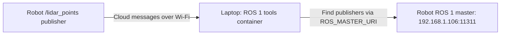

# Livox connection, one step at a time

This is a separate learning setup with one Compose file. Step 1 has one container: ROS 1 tools for inspecting the robot's
live topics. It has its own image and container names and writes captures into this folder's `data/` directory.
We reuse the already-built `x30-ros1-bridge:latest` image for its installed tools; the startup script initializes ROS 1 Noetic.

We will build these layers in order:

1. **ROS 1 inspection (implemented here):** connect to the robot master, find the cloud publisher, and receive a message.
2. **ROS 1 -> ROS 2 bridge (next):** add a bridge, an explicit topic list, and one ROS 2 subscriber; explain DDS discovery.
3. **Robot TF:** include dynamic/static transforms and place the cloud in the robot's coordinate frames.
4. **Visualization and recording:** add Foxglove and a ROS 2 bag recorder as separate subscribers.

## Step 1: The Connection



The master supplies publisher addresses. The tools then connect to the publisher to receive the actual messages.
The master itself does not forward the point-cloud data.

## What Each File Does

| File | Purpose |
|---|---|
| `Dockerfile` | Builds a small local image on top of the existing ROS tools image and selects its startup script. |
| `ros1-env.sh` | Sources Noetic so ROS 1 commands can find their libraries, then executes the requested command. |
| `compose.yml` | Creates one container, gives it robot-network settings, and mounts the recording directory. |
| `.env.example` | Shows the addresses you can supply; Compose does not automatically load this example file. |
| `data/` | Stores generated recordings through the `/data` mount inside the container. |

Read `compose.yml` from top to bottom:

- `name` identifies this Compose project.
- `services.ros1` defines its one container service.
- `build: .` builds the Dockerfile in this directory; `image` names the resulting image.
- `container_name` gives the running container a predictable name.
- `init: true` enables a small process supervisor to handle signals and exited child processes.
- `network_mode: host` gives the container the laptop's networking, allowing ROS 1 to use the laptop's Wi-Fi address.
- `ROS_MASTER_URI` locates the robot's ROS 1 master.
- `ROS_IP` advertises this laptop's robot-network address to other ROS 1 nodes. It is required to avoid accidentally using localhost.
- `extra_hosts` resolves the robot-advertised hostname `ysc-perception` to its IP, matching the working ROB7 connection.
- `./data:/data` makes the local `data/` directory available inside the container at `/data`.

`${ROS_MASTER_URI:-http://192.168.1.106:11311}` uses the supplied variable or that default.
`${ROS_IP:?...}` requires a nonempty value and prints a helpful error otherwise.
You can supply these variables with `export` in your terminal, as below, or through a local `.env` file.

## Start After Connecting To Robot Wi-Fi

```bash
cd /home/a/xxx/VLA_X30/livox_learning
ip route get 192.168.1.106
```

Read the address after `src`. The previous successful connection used `192.168.1.133`; replace it below if your current address differs:

```bash
export ROS_IP=192.168.1.133
export ROS_MASTER_URI=http://192.168.1.106:11311
docker compose up -d --build
```

Docker builds `livox-learning-ros1:local`, creates `livox-learning-ros1`, and runs the startup script followed by
`sleep infinity`. This keeps the tools container available for the following commands.

## Understand Each Check

First, confirm the tools are using ROS 1 Noetic:

```bash
docker compose exec ros1 bash /usr/local/bin/learning-ros1-env rosversion -d
```

Expected: `noetic`. `docker compose exec` starts another process in the existing container. The wrapper sources Noetic
for that process; commands started with Docker exec do not inherit environment changes made by the container's startup process.

Check hostname resolution:

```bash
docker compose exec ros1 getent hosts ysc-perception
```

Expected: `192.168.1.106`. This check is independent of ROS: it verifies that a publisher hostname can be resolved.

Ask the master for the topic list and the cloud's publishers:

```bash
docker compose exec ros1 bash /usr/local/bin/learning-ros1-env rostopic list
docker compose exec ros1 bash /usr/local/bin/learning-ros1-env rostopic info /lidar_points
```

These are discovery checks. They do not prove that a cloud message has arrived.

Receive one real cloud header, with a ten-second timeout:

```bash
docker compose exec ros1 timeout 10 bash /usr/local/bin/learning-ros1-env rostopic echo -n 1 /lidar_points/header
```

Expected: a timestamp and `frame_id`. This proves that the container connected to the publisher and received a message.
The header is a small part of the cloud, so it is readable without dumping the entire point-data buffer into your terminal.

Measure the cloud rate; press Ctrl+C after about ten seconds:

```bash
docker compose exec ros1 bash /usr/local/bin/learning-ros1-env rostopic hz /lidar_points
```

To explore in an interactive shell with Noetic initialized:

```bash
docker compose exec ros1 bash /usr/local/bin/learning-ros1-env bash
```

You can now run `rostopic list`, `rostopic info /lidar_points`, and `rosnode list` directly. Use `exit` to leave that shell.

## Optional ROS 1 Capture

Record a short raw ROS 1 bag, then press Ctrl+C to close it:

```bash
docker compose exec ros1 bash /usr/local/bin/learning-ros1-env rosbag record -O /data/step1_cloud.bag /lidar_points
docker compose exec ros1 bash /usr/local/bin/learning-ros1-env rosbag info /data/step1_cloud.bag
```

The file appears in the local `data/` directory. Use a new filename for another recording.
This first capture contains the cloud only; TF will be added when we build that layer.

## Stop

```bash
docker compose down
```

This removes the learning container. Files in `data/` remain.
Move to step 2 after you can explain why topic discovery can succeed while cloud delivery still fails.
