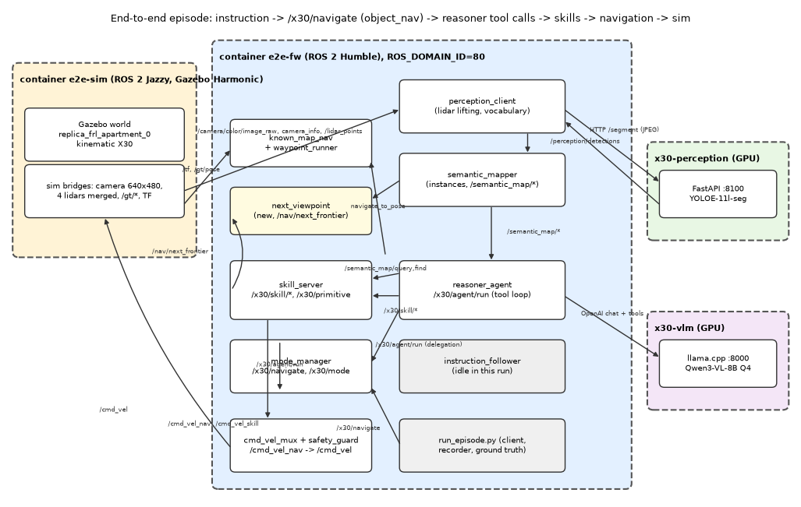

# End-to-end episodes in the simulator (first run, 2026-10-10/11)

Instruction -> `/x30/navigate` (mode `object_nav`) -> mode_manager -> `/x30/agent/run` (reasoner, live Qwen3-VL-8B) -> skills -> known-map navigation -> Gazebo robot, with perception and semantic map in the loop. World `replica_frl_apartment_0`, kinematic locomotion, ground-truth odometry, RTF about 0.33 with sensors (so about 3 s wall per sim second). Everything below was measured in this run; raw data in `results/e2e/` (`ep*/result.json, trajectory.npy, traces/*.jsonl, semmap.json, cam_*.jpg`, logs in `results/e2e/logs/`).

## (a) Architecture

Containers: `x30-vlm` (llama.cpp, :8000), `x30-perception` (YOLOE-11l-seg server, :8100), `e2e-sim` (Jazzy, Gazebo), `e2e-fw` (Humble, all framework nodes). `ROS_DOMAIN_ID=80`, `GZ_PARTITION=e2e`. Inside containers the model servers are reached as `http://vlm:8000/v1` and `http://perception:8100` (configs/models.yaml); from the host use `127.0.0.1`.
Frames: `map` is identity to `odom` (known_map_nav aligns odom to the world once from `/gt/pose`); camera/lidar TF (`TORSO -> camera_optical_frame, lidar_link`) comes from the sim's `/tf_static`; the perception client lifts masks with the merged `/lidar_points`.

## (b) Launch sequence (`bash scripts/e2e/run_e2e.sh [world]`, about 35 s when images and weights are cached)
1. Models: `bash scripts/x30.sh up models`. Check: `curl 127.0.0.1:8000/health` -> `{"status":"ok"}`, `curl 127.0.0.1:8100/health` -> `"ok":true,"backend":"yoloe"`.
2. Sim: `docker run ... --name e2e-sim x30-sim:latest` (exact flags in the script) then `ros2 launch x30_sim sim.launch.py world:=replica_frl_apartment_0 locomotion:=kinematic gui:=false render:=sw`. Check: `/camera/color/image_raw` about 3.3 Hz and `/lidar_points` about 4 Hz wall (RTF 0.33), `/gt/pose`, `/tf`.
3. Framework container `e2e-fw` (own build volumes `e2e_*`), `colcon build --symlink-install --packages-skip x30_sim x30_worlds x30_hw x30_nav_bridge` (10 s).
4. `ros2 launch x30_navigation known_map_nav.launch.py world:=<id> relay:=false` (known_map_nav, waypoint_runner, next_viewpoint). Check: log `aligned: world<-odom`, `/map` latched, `/navigate_to_pose`, `/nav/follow_waypoints`, `/nav/next_frontier` exist.
5. `ros2 launch x30_modes modes.launch.py params_file:=/x30/configs/modes/e2e.yaml use_sim_time:=true`. Check: `/x30/safety` shows `reason: ''`, `scale: 1.0` (if `no_lidar` the guard blocks everything, see (e)); `/x30/navigate`, `/x30/skill/*` exist.
6. `ros2 launch x30_perception perception.launch.py use_sim_time:=true`. Check: `/perception/detections` about 1.6 Hz.
7. `ros2 launch x30_semantic_map semantic_mapper.launch.py use_sim_time:=true vlm_enabled:=false`. Check: `/semantic_map/query`, `/semantic_map/render`.
8. `ros2 launch x30_agent agent.launch.py use_sim_time:=true run_name:=e2e results_dir:=/x30/results/e2e`. Check: `/x30/agent/run`.
9. Vocabulary: `ros2 service call /perception/vocabulary x30_msgs/srv/Json "{request: '{\"op\":\"set\",\"labels\":[\"sofa\",\"chair\",\"tv\",\"bicycle\"]}'}"`.
10. Episodes: `docker exec e2e-fw ... python3 /x30/scripts/e2e/run_episode.py --name ep1_sofa --instruction "Find the sofa and stop next to it." --label sofa` (ep2/ep3 with `--start x y yaw`: `scripts/e2e/run_episodes.sh`). The script teleports with `/sim/set_robot_pose`, restarts known_map_nav (re-alignment), resets the semantic map and viewpoint memory, sends the `Navigate` goal, records trajectory/camera/feedback and scores against `objects.json`.
11. Figures: `python scripts/e2e/make_figs.py`; gallery: `python scripts/make_gallery.py`.
12. Shutdown: `bash scripts/e2e/stop_e2e.sh` (removes `e2e-fw`, `e2e-sim`, stops `x30-vlm`, `x30-perception`; `keep-models` leaves the models). `scripts/e2e/kill_nodes.sh <pattern>` kills nodes in `e2e-fw`. Note: `ros2 node list` crashes against the Jazzy sim ("empty node name"); use topic/service lists.

## (c) Episode walkthrough
Per episode: the client sends the goal; mode_manager sets mode `object_nav` (mux allows the agent source) and delegates to `/x30/agent/run`; each turn the reasoner receives the semantic-map text summary (no images: `images.map/camera false`) and calls one skill: `search` explores with `/nav/next_frontier` (our `next_viewpoint`, goal then a 120 deg scan) while perception (YOLOE, vocabulary sofa/chair/tv/bicycle, lidar lifting) feeds the mapper; `goto_object/approach/goto_pose` call `navigate_to_pose` (known_map_nav A*) through `cmd_vel_nav -> mux -> guard -> /cmd_vel`; `verify` sends a crop plus a fresh camera frame to the VLM. Median model latency 1.3 s per turn (3.3k prompt tokens); wall time is dominated by the simulator.

Reasoner trace, episode 1 (sofa, start = spawn 3.99/-1.51). Result text shortened.
| turn | tool call | result |
|---|---|---|
| 1 | search(sofa) | found sofa #6 (2.8 m), #15, #14 |
| 2 | goto_object(6, 1.0) | failed: robot did not move 0.25 m in 30 s |
| 3 | goto_object(6, 1.5) | failed: no free standoff spot |
| 4 | goto_pose(1.2,-4.0) | failed: point inside obstacle |
| 5 | explore(nearest) | ok, frontier (-0.4,-2.8); new chairs #34, #37 |
| 6 | goto_object(15, 1.0) | failed: no free standoff spot |
| 7 | verify(15) | yes (95), 2.0 m |
| 8 | approach(15, 1.0) | ok, nose 1.05 m |
| 9 | verify(15) | yes (95) |
| 10 | finish(true) | refused: 2.0 m, too far |
| 11 | approach(15, 0.5) | timeout 100 s |
| 12 | goto_object(15, 1.0) | failed: no free standoff |
| 13 | goto_pose(-0.4,-3.1) | ok |
| 14 | turn_to(1) | ok |
| 15 | verify(15) | yes (95) |
| 16 | approach(15, 0.5) | timeout 100 s |
| 17 | goto_object(15, 1.5) | failed: #15 no longer in the map (merged) |
| 18 | goto_object(6, 1.5) | ok, 2.8 m from centre |
| 19 | verify(6) | yes (95) |
| 20 | finish(true) | refused: 2.8 m |
| 21 | approach(6, 0.5) | ok, nose 0.54 m from the surface |
| 22 | verify(6) | yes (95) |
| 23 | finish(true) | accepted after 2 refusals |

Episode 2 (chair; start 3.6/-4.6, yaw 180 deg), 15 turns: search(chair) timeout 370 s (nothing found in 120 sim s), explore, goto_object(#20) x2 failed (no free standoff), verify(#20) NO ("too blurry"), search -> chair #10, goto_object failed, explore, goto_pose, search again -> #10, goto_object failed, verify(#10) NO ("a couch or sofa"), search(rejected 10, 20) "nothing left to explore", finish(false). Episode 3 (tv; start 4.09/-2.71, yaw 0), 19 turns: search found tv #5 (correct, mapped within 0.5 m of the GT tv at 4.38/-9.03); then 15 failed skill calls: goto_object x5 "no free standoff spot", goto_pose into "obstacle" points, explore "none", turn_to/move_relative blocked by the safety guard (clearance 0.05 m), ended `no_progress` ("8 skill failures in a row") at 3.9 m from the tv.

## (d) Results (success = stop issued and distance of the final `/gt/pose` to the nearest GT instance centre <= 1.5 m)
| ep | target / start (world) | result | dist to nearest GT centre | turns | wall / sim time | path | stop reason |
|---|---|---|---|---|---|---|---|
| 1 | sofa / spawn | finished (agent), **fail by criterion** | 2.19 m (about 1.3 m from the GT bbox surface; sofa is 2.2 m long) | 23 | 805 s / 255 s | 18.6 m | finished |
| 2 | chair / 3.6,-4.6,180 deg | **fail** | 3.71 m | 15 | 636 s / 199 s | 12.6 m | no_progress (agent gave up) |
| 3 | tv / 4.09,-2.71,0 | **fail** | 3.91 m | 19 | 338 s / 103 s | 4.4 m | no_progress (8 failures in a row) |

0/3 successful under the strict centre-distance criterion. Causes: ep1 is a borderline criterion issue plus protocol friction (the "finish" guard refused twice because `approach` standoff computation fails on large objects; the stop was valid visually: the end camera frame shows the sofa and the VLM verified it 4 times); ep2 is a detector error (sofa and a blurry object labelled chair, 0.3 confidence; real chairs in the scene were not seen: the 6 GT chairs are small/occluded) amplified by search giving up although 25 viewpoints remained; ep3 is a navigation/geometry failure: the robot ended wedged 0.05 m from furniture with the raw-lidar guard blocking all rotations, and `goto_object` found no free standoff cell next to the tv (against a wall, inside the 0.32 m inflated grid).

## (e) Problems found and what was changed
1. `/nav/next_frontier` did not exist in known-map mode: added `x30_navigation/next_viewpoint.py` (node `next_viewpoint`, registered in `known_map_nav.launch.py` and `setup.py`): unseen-free-cell coverage, camera frustum with grid ray casting, 1.2 m visited disc, nearest-first by BFS, same JSON as the frontier explorer, `/nav/next_viewpoint/reset`. First version returned the robot's own cell forever (53 "frontiers" without moving, 120 s no_progress); the visited disc fixed it. Not unit-tested.
2. The safety guard read `/costmap_cloud`, which known-map mode does not produce -> state `no_lidar`, scale 0, every `/cmd_vel` zero. Added `configs/modes/e2e.yaml` (sim.yaml + `costmap_cloud_topic: /lidar_points` for guard and skill_server). Edits to other agents' areas: only `x30_navigation` (new node, launch, setup.py) and the new config file.
3. `pkill -f` inside `docker exec bash -lc` kills its own shell and left duplicate mux nodes; `scripts/e2e/kill_nodes.sh` and bracketed patterns in `run_episode.py` fix it.
4. Observed, not fixed: reasoner and follower warn that `/semantic_map/annotated_map` has incompatible QoS (DURABILITY), so the map image is not available (images are off anyway); `explore` returns `remaining` frontiers but `search` then reports "nothing left" when `rejected_ids` are given; repeated "no free standoff spot" because `goto_object` uses the inflated `/map`; first object positions have up to 0.8 m error for large objects (centre vs visible surface).
5. Detector: the vocabulary restricted to sofa/chair/tv/bicycle gave sofa and tv reliably (tv #5/#4 within 0.1-0.5 m of GT), chairs poorly. The optional `oracle_detector` ablation was not built (budget).

## (f) Known gaps
* 0/3 success: two failures are infrastructure (viewpoint search policy, standoff computation, guard in tight places), one a detector label error; the sample is 3 episodes with one seed, no repeated runs, so no rates can be claimed.
* The 1.5 m centre-distance criterion penalises large objects; a surface-distance variant should be added to `x30_eval`.
* RTF 0.33 (software rendering) makes an episode 6-14 min wall; `RENDER=gpu` untested here.
* No oracle detector, no images to the reasoner, semantic mapper without VLM captions (`vlm_enabled:=false`), instruction_follower idle, odometry is ground truth, static known map.
* Next steps: (1) make `goto_object` standoff search use the uninflated grid or the nearest reachable cell; (2) let the guard use a small self-filtered `/costmap_cloud` (known-map launch should publish it); (3) restrict search to unseen viewpoints that are far from rejected objects and let it continue after a rejected candidate; (4) add the oracle detector; (5) repeat with 10+ episodes per world and the surface criterion.

## (g) Plan B scripts and the first aws_hospital runs (2026-10-11, session 2)
Scripts (all in `scripts/e2e/`): `sample_tour.py` (host; tour waypoints from the world's 2D map), `build_map.py` (mapping phase: scan tour with `goto_pose` + `scan`, or `--frontier`; saves the semantic map in the WORLD frame to `results/maps/<world>.json` and a per-label recall report vs `objects.json`), `mapframe.py` (world <-> map frame; known_map_nav's map frame is the start pose: map = R(-yaw)(world - start)), `run_episode.py --load-map <file>` (loads a saved map instead of resetting it; needs `--start` or uses the current pose), `time_goal.py` (times goal acceptance of `navigate_to_pose`). Switch world: `stop_e2e.sh keep-models`, then `run_e2e.sh <world>` (about 3 min incl. world load; hospital RTF about 0.4 with software rendering, camera and lidar 4 Hz).

Measured:
* **replica_frl_apartment_0 mapping tour** (8 waypoints, 0.40 m clearance): only waypoint 0 reached, the robot then climbed onto furniture near world (4.67, -3.75) (z 0.63, about 39 deg pitch) and the tilt guard locked it. Map recall 8/62 GT objects (sofa 1/1, tv 1/2, chair 2/6, table 2/7, vase 0/3). The 2D nav map of this apartment has only 35.6 m2 free (about 11 m2 connected at 0.40 m clearance), which also explains unreachable frontiers. Data: `results/maps/replica_frl_apartment_0.report.json`.
* **Bug found and fixed in `known_map_nav`** (`x30_navigation`): the ActionServer had no `cancel_callback`, so rclpy rejected every cancel; timed-out skills left goal loops running (still publishing `/cmd_vel_nav`, 40 Hz seen with no episode active) and four of them filled the 4-thread executor, after which new goals got no answer (`nav2_no_response`; `time_goal.py`: no accept in 60 s). Fix: accept cancels, new goal pre-empts the old one (`goal_gen`). After: accept in 0.00 s. This probably also contributed to the "wedged / no free standoff" failures of the first e2e run (not re-measured).
* **Stale `frontier_explorer` nodes** left in `e2e-fw` answered `/nav/next_frontier` in another format (`goal` as a list); `explore` now accepts both formats. `stop_e2e.sh` removes the containers, which clears them.
* **aws_hospital, "Find the bed and stop next to it."** (online mapping, start 0.93/11.48, vocabulary bed/sofa/chair/toilet/cabinet/shelf/cart/sink/table, 600 s limit): run 1 (before the fix) 0 success, 30 turns, `nav2_no_response` from turn 10; run 2 (after the fix) **0 success**, stop reason `no_progress` (8 failures in a row), 29 turns, 35.1 m path, 1337 s wall / 568 s sim; nearest GT bed 16.8 m from the end pose. `goto_object` now reached its target 4 times, so navigation works. The failure is perception: the map's 'bed' objects #127, #128, #161 are false positives (verify: "a railing or barrier", "a grid-like structure", "a vertical structure"; in run 1 bed #68 was "a reception desk"). The VLM verify refused them correctly 5 times, so the verify step works; no true bed was ever mapped. Then the robot ended pressed against a railing (guard: obstacle 5 cm in front and behind, rotation blocked), turns 19-29 all failed.
* Not measured: GPU rendering (RENDER=gpu), the oracle detector, any success rate (n = 2 episodes, one world).
