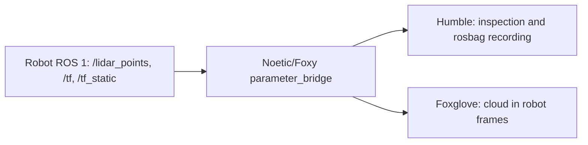

# Live Livox cloud with robot TF

This setup builds on ROB7's host-network Noetic/Foxy `parameter_bridge` and Humble workstation architecture.
It receives the robot's merged `/lidar_points` cloud, native `/livox/lidar` CustomMsg, IMU streams, and `/tf` and `/tf_static`.
The clouds are live scans, not an accumulated global map. Neither UDP `x30_nav_bridge` nor `real_adapter` is needed.



## Construction

- `docker/compose.yml` defines the existing bridge, idle framework, and Foxglove services.
- `docker/compose.real.yml` gives them host networking so ROS 1 callbacks can reach the workstation.
- `docker/compose.livox.yml` selects the Livox topic list, names the containers `x30-livox-*`, and uses ROS 2 domain 30 by default.
- `configs/ros1_bridge_topics_livox.yaml` selects the native and merged clouds, IMUs, and the two TF topics.
- `docker/dds/cyclonedds-local.xml` keeps Foxy/Humble DDS on workstation loopback, using unicast discovery.
- `docker/images/livox_bridge/` builds message-only `livox_ros_driver2` packages for Noetic, Foxy, and Humble,
  then rebuilds Foxy `ros1_bridge` 0.9.7 with the native custom-message mapping.

The Livox overlay also maps the robot-advertised hostname `ysc-perception` to `192.168.1.106`, matching ROB7,
and names its ROS 1 bridge `x30_livox_bridge` to avoid colliding with an existing `/ros_bridge`.
It mounts the current entrypoint script. Native CustomMsg support requires the custom images described below.

The robot is the TF authority in this domain. The parameter bridge creates **both directions** for each topic;
this is a consumer-only workflow, not a one-way bridge. Do not launch `x30_hw real.launch.py`, our navigation/mapping stack,
static transform publishers, simulator, or bag playback in this domain: their TF or clouds would also reach ROS 1.
Use a different `LIVOX_ROS_DOMAIN_ID` if domain 30 is already in use. The cloud-only topic list contains no motion commands.

`/tf_static` uses `keep_all` and `transient_local` so later subscribers receive retained transforms,
following the [Foxy ros1_bridge QoS example](https://github.com/ros2/ros1_bridge/blob/foxy/README.md#parametrizing-quality-of-service).
Actual robot TF frames and `/tf_static` availability must be inspected; the bridge does not invent missing transforms.

## Build Native Message Support

Run from `x30_vln/`. Prepare the upstream source once; the helper reuses source from an existing Livox bridge image,
or downloads release 0.9.7 if no cached image is available (that first download requires normal internet):

```bash
bash docker/images/livox_bridge/prepare-source.sh
docker compose -f docker/compose.yml -f docker/compose.real.yml -f docker/compose.livox.yml \
    --profile real build ros1_bridge framework
```

The build uses the existing `x30-ros1-bridge:latest` and `x30-framework:latest` images and prepared local source.
Docker build steps do not download source and can run on robot Wi-Fi. The outputs are `x30-livox-bridge:latest` and `x30-livox-framework:latest`.
The tools service uses the latter so Foxglove can also discover the Livox message schema.
These packages define messages only; no additional lidar driver is launched against the robot's sensors.

`/livox/lidar` is forwarded as `livox_ros_driver2/msg/CustomMsg`, preserving stamp, frame, timebase, lidar ID,
point count, and every point's offset_time, coordinates, reflectivity, tag, and line.
This is a native-message bridge, not a converter from `/lidar_points`. The original merged cloud remains available for viewing.
The node forwards whichever native devices the robot publishes on that topic; inspect `lidar_id` and frame IDs before choosing FAST-LIO inputs.

For an offline regression check with synthetic ROS 1 inputs and Humble subscribers:

```bash
bash docker/scripts/proof_livox_bridge.sh
```

It tests exact custom fields (including large uint64 timestamps), all five IMU streams, the existing PointCloud2 path,
and retained static TF. Its ROS 1 master and ROS 2 DDS run on workstation loopback; it never contacts the robot.

## Start On Linux

For a manual robot-Wi-Fi test, use the steps in [LIVOX_WIFI_TEST.md](LIVOX_WIFI_TEST.md).
They select the workstation address after switching networks and do not require a `.env` file.

Run from `x30_vln/`, with the existing Docker images built. Set the existing `.env` entries to your actual network:

```dotenv
# ROB7 example addresses: confirm these match the connected robot and workstation.
ROS_MASTER_URI=http://192.168.1.106:11311
ROS_IP=192.168.1.131
LIVOX_ROS_DOMAIN_ID=30
LIVOX_FOXGLOVE_PORT=8766
```

`ROS_MASTER_URI` locates the ROS 1 master; `ROS_IP` is this workstation's reachable address on the robot network.
Use native Docker Engine and wired Ethernet for the roughly 21 MB/s merged cloud. DDS settings are supplied by the Livox overlay.

Define this shell helper, then start the selected services:

```bash
livox_compose() {
    docker compose --env-file .env \
        -f docker/compose.yml -f docker/compose.real.yml -f docker/compose.livox.yml \
        --profile real "$@"
}
livox_compose up -d ros1_bridge framework tools
livox_compose logs --tail 50 ros1_bridge
```

This starts three separate Livox containers. Models and simulation are not started. The framework remains idle until
you run an inspection or recording command. `scripts/x30.sh up real --host-net` does not select this overlay.

## Inspect And View

Inspect the robot's ROS 1 topics through the bridge container's Noetic-only helper:

```bash
docker exec x30-livox-bridge x30-bridge-entrypoint ros1 rostopic list
docker exec x30-livox-bridge x30-bridge-entrypoint ros1 rostopic type /livox/lidar
docker exec x30-livox-bridge x30-bridge-entrypoint ros1 rostopic info /lidar_points
docker exec x30-livox-bridge x30-bridge-entrypoint ros1 rostopic echo -n 1 /lidar_points/header
docker exec x30-livox-bridge x30-bridge-entrypoint ros1 rostopic info /tf
docker exec x30-livox-bridge x30-bridge-entrypoint ros1 rostopic info /tf_static
```

Check the ROS 2 side:

```bash
docker exec x30-livox-framework bash -lc 'ros2 topic list -t --no-daemon'
docker exec x30-livox-framework bash -lc 'ros2 interface show livox_ros_driver2/msg/CustomMsg'
docker exec x30-livox-framework bash -lc 'timeout 10 ros2 topic echo /livox/lidar livox_ros_driver2/msg/CustomMsg --no-daemon --field point_num --once'
docker exec x30-livox-framework bash -lc 'ros2 topic hz /lidar_points'
docker exec x30-livox-framework bash -lc 'ros2 topic echo /tf --no-daemon --once'
docker exec x30-livox-framework bash -lc 'ros2 topic echo /tf_static --no-daemon --qos-durability transient_local --once'
```

Stop the rate monitor with Ctrl+C. Connect Foxglove to `ws://localhost:8766`, add a 3D panel, and enable `/lidar_points`.
Start with the cloud's actual `header.frame_id` as the display frame (`lidar_link` in our recorded bag).
Then select a robot fixed frame such as `odom` or `map` only if the received TF tree connects it to that cloud frame.
For example, when those frame names exist:

```bash
docker exec x30-livox-framework bash -lc 'ros2 run tf2_ros tf2_echo odom lidar_link'
```

A cloud displayed in its sensor frame needs no external transform. A missing fixed-frame transform requires inspecting
the robot's TF publishers and clocks; an identity transform would conceal the missing calibration or pose.
Compare ROS 1 and ROS 2 data rates if topics appear but no samples arrive; check robot-to-workstation callbacks,
the advertised `ROS_IP`, and bridge logs. A ROS 2 topic listed by the parameter bridge alone does not prove robot data is arriving.

For FAST-LIO, check `/livox/lidar` and its intended IMU topic have real samples with compatible timestamps and measured extrinsics.
The bridged choices are `/imu/data` and `/livox/imu_192_168_2_202` through `_205`.
Their availability does not establish which IMU belongs with a given lidar; identify that pairing on the robot.
The selected FAST-LIO version must consume `livox_ros_driver2/CustomMsg` (upstream ROS 1 FAST-LIO uses `livox_ros_driver/CustomMsg`).

## Record

Run an interactive recorder; Ctrl+C closes the bag cleanly:

```bash
docker exec -it x30-livox-framework bash -lc \
    'mkdir -p /x30/datasets/real; ros2 bag record -o /x30/datasets/real/livox_$(date +%Y%m%d_%H%M%S) /livox/lidar /lidar_points /imu/data /livox/imu_192_168_2_202 /livox/imu_192_168_2_203 /livox/imu_192_168_2_204 /livox/imu_192_168_2_205 /tf /tf_static'
```

The bag is written under the host's `x30_vln/datasets/real/` bind mount. Record all TF, including retained static TF;
inspect the recorder's subscriptions/logs and verify topic counts with `ros2 bag info <bag-directory>`.
If the robot publishes no `/tf_static`, that topic has no samples. Replay later in a separate domain from the live bridge.
This preserves complete scans and their transforms; exporting a single PCD/PLY frame is a separate step.

## Stop

In the shell where `livox_compose` was defined:

```bash
livox_compose down
```

The `x30-livox` Compose project has separate container names from the main stack. Named workspace build/install volumes
are shared with the framework; do not rebuild that workspace concurrently with another build. Recorded bags remain on the host.

## Verification

Verified locally on 2026-10-14 with the built Foxy bridge (0.9.7) and Humble images, a fake ROS 1 source on loopback,
and the same topic/DDS configuration. Cloud payload and frame survived conversion; a late subscriber received the
single static TF publication and resolved `odom -> base_link -> lidar_link`. A recorder started afterwards captured
64 clouds, 64 dynamic TF messages, and one retained static TF message. Compose configuration also resolved successfully.
This verifies the bridge plumbing with synthetic data; robot networking, actual TF coverage, and full Livox throughput
remain to be checked on hardware.

Native-message extension verified on 2026-10-14: the rebuilt bridge lists both Livox conversion pairs;
the loopback proof delivered native CustomMsg, merged PointCloud2, every selected IMU topic, dynamic TF, and retained static TF to Humble.
It checked exact point fields, uint64 timebase, header timestamps, lidar ID, and reserved bytes.
The bridge source is now cached locally and Docker build steps work without GitHub access.
The Livox containers were upgraded to these images with the existing robot addresses; native robot delivery still needs
checking while connected to robot Wi-Fi.

The bridge logs subsequently confirmed real robot CustomMsg forwarding. A stale Humble CLI daemon caused
`xmlrpc.client.Fault: !rclpy.ok()` during topic echo; stop the daemon and use `--no-daemon` as shown above.
See `LIVOX_WIFI_TEST.md` for the explanation and recovery commands.
