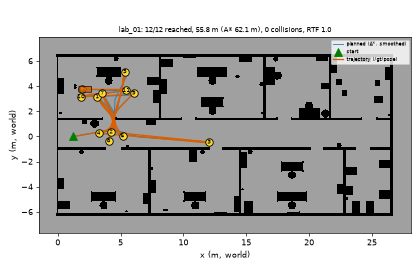
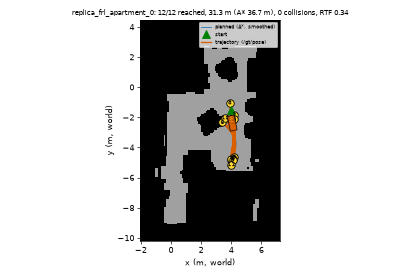

# Known-map navigation (`known_map_nav`, `planner_backend: known_map`)

Simple navigation for the simulator: no SLAM, no Nav2, no mapping. The ground-truth 2D occupancy grid of the world (`map_file` in `datasets/registry.yaml`, written by `x30_datasets`) is the map; the odometry is the simulator's ground-truth odometry (TF `odom -> base_link`).

## What it does
* `known_map_nav` (`x30_navigation/known_map_nav.py`; planner and controller are ROS-free in `known_map.py`) loads the grid of a registry world id, resamples it to 0.1 m (any occupied fine cell blocks), publishes it latched on `/map` (inflated by `map_inflation` = 0.32 m, 100 = occupied, 99 = inflated).
* Planning: 8-connected A* (no corner cutting), cost = length x (1 + 3 x closeness^2 inside 0.9 m of an obstacle), then line-of-sight smoothing and resampling every 0.25 m. Clearance tiers for the X30 kinematic body (1.0 x 0.46 m): **0.55 m** (half-length 0.5 + margin 0.05, so in-place rotation is safe), then 0.42, then 0.32 m (half-width + margin + 0.04) when the wide tier does not connect.
* Tracking: the pure-pursuit law of `direct_nav`, re-written in `control()` with holonomic motion: in-place rotation only where the clearance is >= 0.5 m (above 0.7 rad heading error); in tight places (< 0.5 m) the body slides toward the path (vy up to 0.25 m/s) and turns at most 0.25 rad/s. Speed ramps from 35 % to 100 % of 0.45 m/s as the clearance goes 0.3 -> 0.9 m (clearance read from the grid distance transform; this replaces the safety guard / lidar because the world is static and known) and ramps down inside 1.0 m of the goal.
* Replanning every 3 s from the current pose. If the body does not move for 4 s sim time (wedged), it slides back 0.35 m, puts a temporary 0.3 m blocker 0.7 m ahead and replans. A goal without 0.15 m progress for 30 s sim time aborts. (Neither recovery fired in the two runs below.)
* Interface: serves `navigate_to_pose` exactly like Nav2 / `direct_navigator`, so `waypoint_runner` and `/nav/follow_waypoints` (`{"waypoints": [[x,y],...], "radius": 0.4, "timeout_s": ...}`) work unchanged. Also publishes `/nav/known_map_info` (JSON: planned path, A* length, tier).

## Frames (alignment)
The grid is in the **world** frame (registry, SDF, `/gt/pose`). In the simulator the robot starts at the spawn pose while odom starts at 0, and `/sim/set_robot_pose` resets odom. `known_map_nav` therefore computes once `T_world_odom = gt_pose * odom_pose^-1` from `/gt/pose` and TF `odom -> base_link` (`align:=gt`, default; `align:=spawn` uses the registry spawn pose instead). The `map` frame **is** the odom frame (a static identity TF `map -> odom` is published; `publish_map_odom_tf:=false` disables it); the grid is published with the origin and yaw that put it there. Waypoints sent to `/nav/follow_waypoints` are in odom coordinates (robot start = 0,0): `odom = R(-yaw0) (world - spawn)`. If odom is reset after the node aligned (set_robot_pose / reset_world), restart the node.

## Launch (exact commands)
Simulator (own container, kinematic, domain 20, own Gazebo partition; `<proj>` = project directory):
```
docker run -d --name kn-sim --network x30_net --init --shm-size 2gb -e RMW_IMPLEMENTATION=rmw_cyclonedds_cpp -e ROS_DOMAIN_ID=20 -e CYCLONEDDS_URI=file:///etc/x30/cyclonedds.xml -e X30_ROOT=/x30 -e X30_CONFIGS=/x30/configs -e GZ_PARTITION=kn -e RENDER=sw -v <proj>/ros2_ws/src:/ws/src -v <proj>:/x30 -v x30_sim_ws_build:/ws/build -v x30_sim_ws_install:/ws/install -v x30_sim_ws_log:/ws/log -v <proj>/docker/dds:/etc/x30:ro x30-sim:latest sleep infinity
docker exec -d kn-sim bash -lc '. /usr/local/bin/x30-env; export ROS_DOMAIN_ID=20 GZ_PARTITION=kn; ros2 launch x30_sim sim.launch.py world:=lab_01 locomotion:=kinematic gui:=false render:=sw'
```
Framework container (same `docker run` with `x30-framework:latest`, `-v x30nav_build:/ws/build -v x30nav_install:/ws/install -v x30nav_log:/ws/log`, without GZ_PARTITION/RENDER), once after a code change: `colcon build --symlink-install --packages-select x30_navigation` in `/ws`. Then:
```
docker exec -d kn-fw bash -lc 'source /opt/ros/humble/setup.bash; source /ws/install/setup.bash; export ROS_DOMAIN_ID=20; ros2 launch x30_navigation known_map_nav.launch.py world:=lab_01'
docker exec kn-fw bash -lc 'source /opt/ros/humble/setup.bash; source /ws/install/setup.bash; export ROS_DOMAIN_ID=20; ros2 run x30_navigation known_map_bench --world lab_01 --out /x30/results/known_map/lab_01'
# own waypoint list (odom frame):
ros2 service call /nav/follow_waypoints x30_msgs/srv/Json "{request: '{\"waypoints\": [[2.0, 1.0], [4.0, 3.0]], \"radius\": 0.4}'}"
# visual record, on the host:
python scripts/sim/make_nav_viz.py results/known_map/lab_01 docs/figures/navigation/known_map_lab_01
```
The launch file starts `known_map_nav`, `waypoint_runner` (parameter `planner_backend: known_map`) and `cmd_relay` (`relay:=false` when the x30_modes mux owns `/cmd_vel`; `known_map_nav` publishes `/cmd_vel_nav`). In the full system the x30_modes `safety_guard` / `cmd_vel_mux` stay in the path as for the other backends. Stop with `docker stop kn-fw kn-sim; docker rm kn-fw kn-sim`.

## Parameters (`known_map_nav`)
`world` (registry id), `map_yaml` (override), `registry`, `worlds_root`, `grid_resolution` 0.1, `align` gt|spawn, `margin` 0.05, `body_half_length` 0.5, `body_half_width` 0.23, `map_inflation` 0.32, `goal_radius` 0.25 (the runner scores with its own `radius`, 0.4), `replan_period_s` 3, `wedge_window_s` 4, `backup_m` 0.35, `stuck_timeout_s` 30, `timeout_s` 240 (sim s), `rate_hz` 10, `cmd_topic` /cmd_vel_nav, controller `ctrl.*` (`v_max` 0.45, `vy_max` 0.25, `wz_max` 0.6, `lookahead` 0.6, `turn_in_place` 0.7, `slow_clear_lo/hi` 0.3/0.9, `slow_floor` 0.35). Unit tests (no ROS): `python -m pytest ros2_ws/src/x30_navigation/test/test_known_map.py` (4 pass).

## Results (Gazebo, kinematic, ground-truth odometry, domain 20, 12 waypoints each, tolerance 0.4 m)
| world | reached | driven / A* length | sim time | RTF | collisions (body rectangle vs GT raster) |
|---|---|---|---|---|---|
| lab_01 (procedural) | 12/12 | 55.8 m / 62.1 m | 233 s | 1.0 | 0 |
| replica_frl_apartment_0 (Replica scan, about 250 k triangles) | 12/12 | 31.3 m / 36.7 m | 186 s (541 s wall) | 0.34 | 0 |

The final error was 0.24-0.25 m for all 24 goals (the node stops inside 0.25 m). "A* length" is the planned length between consecutive waypoints on the same grid; the driven path is shorter because the smoothing cuts corners (clearance stays >= the tier radius on the smoothed path). Waypoints: random, >= 2.5 m apart along the path, >= 0.7 m clearance, reachable with the 0.55 m tier; seed 1. Files: `results/known_map/<world>/{result.json,trajectory.npy,bench.log,frames/}`, `results/known_map/nav_<world>.log`. Visual record: `docs/figures/navigation/known_map_<world>.png` and `.gif` (top-down grid, planned paths, waypoints, /gt/pose trajectory), camera frames `known_map_<world>_cam*.jpg`.

 

Animations (not in the gallery): `figures/navigation/known_map_lab_01.gif`, `figures/navigation/known_map_replica_frl_apartment_0.gif`.

## Limits
* Static world only: the grid comes from the world file. Moving or unlisted obstacles are noticed only through the wedge recovery (contact), not through the lidar; for a dynamic world keep the x30_modes safety guard in the loop.
* Needs the ground-truth map and a drift-free odometry (simulator). On the real robot it would need localisation against the map; it is not a SLAM replacement.
* The 0.55 m tier excludes narrow passages from goal sampling: in the Replica flat the 12 goals fall in the part of the flat with that clearance (the plot shows a small area), and the narrower tiers (0.42, 0.32 m) were only exercised by the unit test, not by these runs.
* Rotation safety is a clearance rule (0.5 m disc), not a swept-footprint check; tight places are passed holonomically, tested in kinematic mode only (not legged).
* The collision metric uses the 0.05 m raster of the scan; the mesh the physics sees can differ slightly. `replica_apartment_1` (where the earlier backends wedged) was not rerun. One seed per world.
* Odom reset after the node aligned requires a node restart (see Frames).
